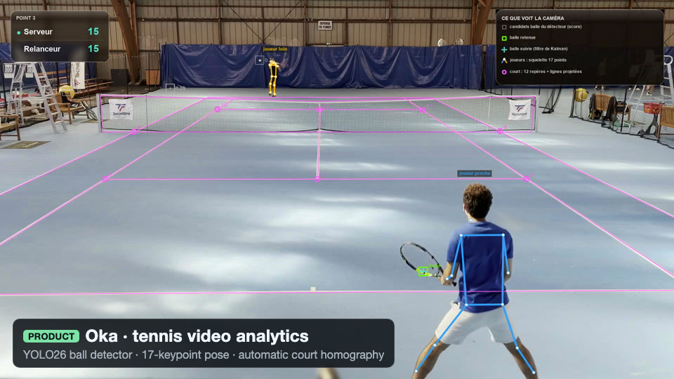
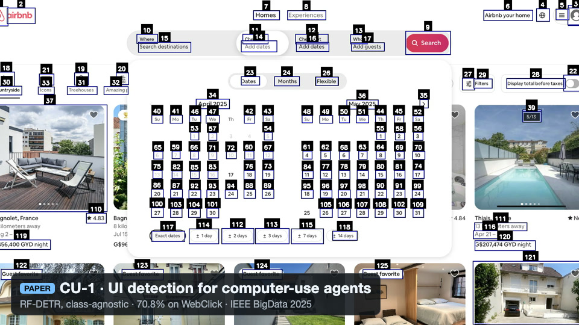
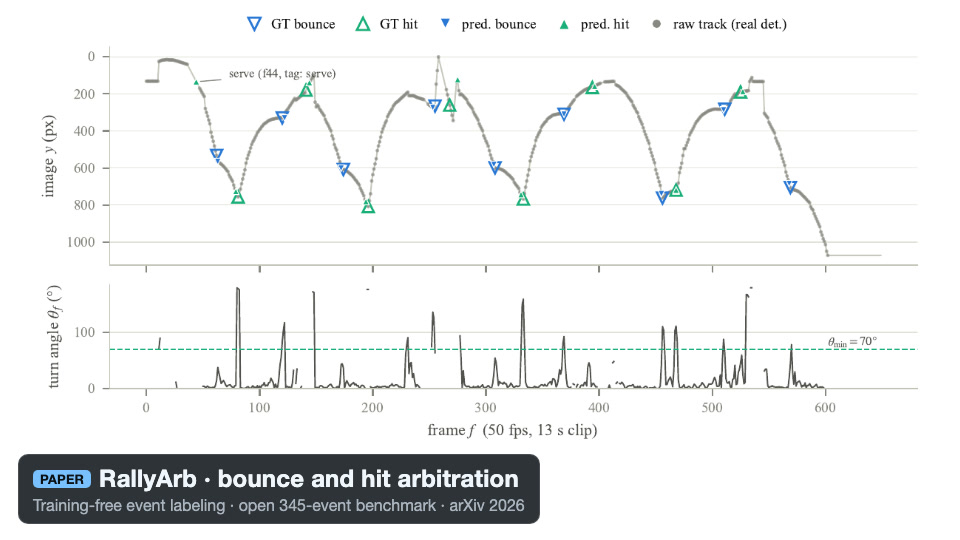
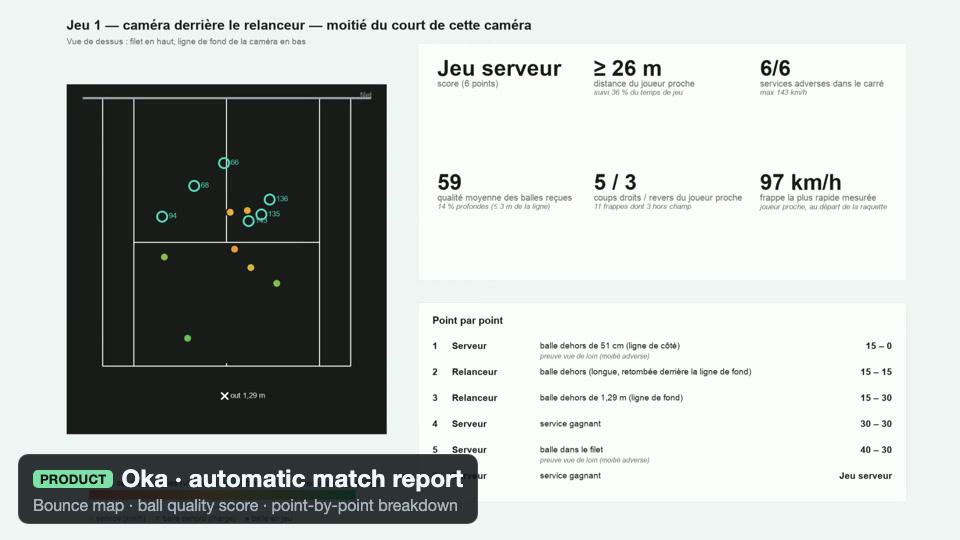
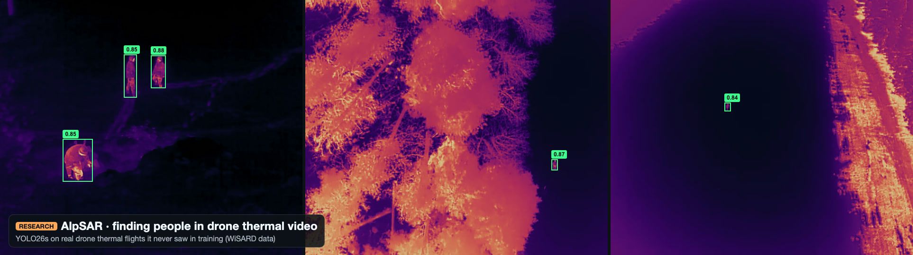

<table>
<tr><td>

  

### 👋 Hey, I'm David

AI engineer in training (Data & AI at ECE Paris) and AI developer at Racine.ai. I build computer vision and LLM systems that run on real data: tennis video analytics, UI detection for computer-use agents, people detection from drone thermal cameras, retrieval for large document bases. Some of them became papers.

</td></tr>
<tr><td><b>research</b> 

- **Can Event Detectors Leave the Broadcast Camera? Evidence from Tennis** · D. Soeiro-Vuong, A.-L. Rochet · arXiv 2026 · [paper](https://arxiv.org/abs/2610.38042) · [benchmark](https://github.com/David-dsv/tennis-bounce-hit-benchmark) (345 frame-exact bounce and hit events)
- **CU-1**, a class-agnostic RF-DETR detector of UI elements for computer-use agents, 70.8% on WebClick (+20% over the previous state of the art) · IEEE BigData 2025, co-author · [model](https://huggingface.co/racineai/UI-DETR-1)
- **AlpSAR** (in progress) · finding people in drone thermal video for mountain rescue. Baselines trained on real drone footage, synthetic RGB + thermal data in Unreal Engine 5 on the way, every model evaluated on real flights it never saw in training

Thermal frames in the showcase: <a href="https://sites.google.com/uw.edu/wisard">WiSARD</a> dataset (Broyles, Hayner and Leung, 2022).

</td></tr>
<tr><td><b>building</b> 

- **Oka** · tennis analytics from a single club camera: fine-tuned YOLO26 ball detector (mAP50 0.94), Kalman tracking, pose, automatic court homography (line detection + RANSAC), 97x faster than real time on CPU, full stack on FastAPI, Supabase, Next.js and Modal
- **Retrieval for a major energy group** · OCR, fine-tuned Qwen3-Embedding-4B, Qwen3-VL reranking served on vLLM
- **Tender grading pipeline** · 1,000+ requirements scored by an LLM with hybrid retrieval (pgvector + full text, RRF) and NLI verification

</td></tr>
<tr><td><b>languages</b> 
   
</td></tr>
<tr><td><b>vision / ml</b> 
    
</td></tr>
<tr><td><b>llm / agents</b> 
    
</td></tr>
<tr><td><b>frontend</b> 
 
</td></tr>
<tr><td><b>infra</b> 
       
</td></tr>
</table>
